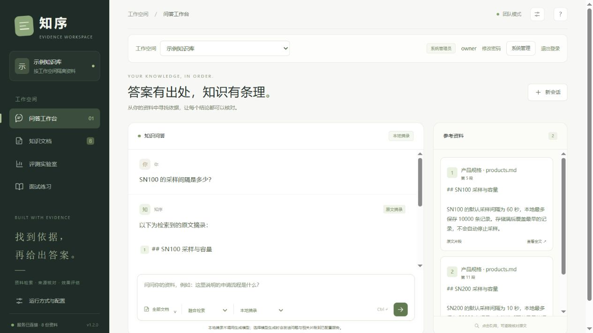

# Zhixu · Local document search for individuals and small teams



The screenshot shows the main workspace. Team mode adds login, workspace selection and administration.

[简体中文](README.md) · [Detailed guide (Chinese)](docs/user-guide.md) · [Code walkthrough (Chinese)](docs/code-walkthrough.md) · [Team operations](docs/enterprise-operations.md) · [HTTP API](docs/api.md) · [Contributing](CONTRIBUTING.md) · [Security](SECURITY.md)

Turn PDF, DOCX, Markdown and TXT files into searchable workspaces with inspectable sources. Default personal mode needs no account to search and read excerpts locally. Explicit team mode adds accounts, workspace membership and roles. Both modes can optionally use local BGE retrieval or a generation service you operate or are authorized to use.

This 1.2.0 iteration supports individuals, researchers and controlled small-team deployments. Team mode is a **single-organization deployment foundation**, not a claim of production maturity, SSO, multi-organization SaaS, high availability or security certification. A valid citation does not prove that a conclusion is supported.

## Choose a mode

| Mode | Intended use | Data and access |
| --- | --- | --- |
| Default personal mode | Personal research and learning on a trusted local machine | No login; `knowledge.db` in the selected data directory |
| `--enterprise` team mode | An authorized small team within one organization | Initialize an administrator first; accounts, separate workspace databases and API role checks |

Do not expose anonymous personal mode to a team through a reverse proxy. Use a separate data directory, `--enterprise` and an HTTPS proxy; see [team operations](docs/enterprise-operations.md). The original personal `data/knowledge.db` is not automatically migrated into or shared with team workspaces.

## Retrieval and generation are separate

| Capability | Behavior | Requirements |
| --- | --- | --- |
| Lexical retrieval + excerpts | Default BM25/TF-IDF with RRF ranking; returns source text | No generation model or API key |
| Local semantic retrieval | Optional BGE-small-zh-v1.5, 512 dimensions, fixed 0.65 cosine cutoff | Optional dependency and local weights; no external API key |
| Source-based generation | Optional Chat Completions-compatible service | Loopback servers may omit a key; remote services require HTTPS and a key |

Semantic retrieval selects passages; it does not generate answers. Similarity is not a correctness probability. Generation errors or invalid responses fall back to excerpts with an explicit warning.

## Run from source

```sh
git clone https://github.com/Chichi1228119/zhixu.git
cd zhixu
```

Requires Python 3.12+. Download the source and enter the directory containing `pyproject.toml`. There is no PyPI release yet; do not use `pip install zhixu`.

Windows PowerShell:

```powershell
py -3.12 -m venv .venv
.\.venv\Scripts\python.exe -m pip install -e ".[dev]"
.\.venv\Scripts\zhixu.exe --version
.\.venv\Scripts\zhixu.exe serve --data-dir .\data --model-dir .\models --no-browser
```

Linux / macOS:

```sh
python3.12 -m venv .venv
.venv/bin/python -m pip install -e '.[dev]'
.venv/bin/zhixu --version
.venv/bin/zhixu serve --data-dir ./data --model-dir ./models --no-browser
```

Open <http://127.0.0.1:18765>. Stop the foreground server with `Ctrl+C`. The CLI accepts loopback hosts only and does not open a browser by default; `--no-browser` is a compatibility flag.

The default workspace is empty. To import the eight explicitly fictional demo documents into a **new** database, append `--demo` to the command above. The full CLI form is `zhixu serve --data-dir ./data --model-dir ./models --demo --no-browser`. The document page can also restore the demo. Fictional company policies are not real-world commitments.

| Option | Meaning |
| --- | --- |
| `--data-dir` | Writable data directory; `knowledge.db` in personal mode, the team layout below otherwise; defaults to `data/` under the working directory |
| `--model-dir` | Optional model cache; defaults to `models/` alongside the data directory |
| `--host` / `--port` | Defaults to `127.0.0.1:18765`; public bind addresses are rejected |
| `--demo` | Seeds only a new personal database; writable team members add examples explicitly |
| `--enterprise` | Enables accounts and workspace permissions after administrator initialization; `ZHIXU_ENTERPRISE=1` also enables it |

Explicit CLI paths override `ZHIXU_DATA_DIR` and `ZHIXU_MODEL_DIR`. Reports default to `reports/` alongside the data directory; `ZHIXU_REPORT_DIR` can override this. Writable runtime data is separate from installed resources. Stop the service and back up your data before moving it. Windows launch/stop scripts are local conveniences; the CLI is the portable entry point.

## Team mode: initialize, then grant access

Run these commands in the source environment or an environment with the release wheel installed. Windows PowerShell:

```powershell
.\.venv\Scripts\zhixu.exe admin init --data-dir .\team-data --username owner
.\.venv\Scripts\zhixu.exe serve --enterprise --data-dir .\team-data --model-dir .\models --port 18769 --no-browser
```

Linux / macOS:

```sh
.venv/bin/zhixu admin init --data-dir ./team-data --username owner
.venv/bin/zhixu serve --enterprise --data-dir ./team-data --model-dir ./models --port 18769 --no-browser
```

`admin init` prompts twice with `getpass` for a 12–128-character password; it does not accept a command-line password. Usernames contain 3–64 ASCII letters, digits, `_`, `.` or `-` and are case-normalized. There is no default password, public registration or browser bootstrap. Initialization creates the first system administrator and a default workspace; it cannot bootstrap again once accounts exist.

Open <http://127.0.0.1:18769> and sign in. A system administrator creates users and workspaces and grants membership. Users with no workspace must wait for a grant. Team documents live in `team-data/workspaces/<server-generated-id>/knowledge.db`; identities, sessions and audit metadata live in `team-data/control.db`. The personal database is not used as shared content.

| Role | Read and ask in allowed workspaces | Import, delete and add examples | Users and membership grants | Model settings and global evaluation |
| --- | --- | --- | --- | --- |
| viewer | Yes | No | No | No |
| editor / workspace admin | Yes | Yes | No | No |
| System administrator | All workspaces | Yes | Yes | Yes |

Workspace admin currently has the same document permissions as editor, without global account management. APIs enforce permissions; disabled buttons are explanatory. Revocation applies on the next request. Disabling an account or changing/resetting its password revokes all its sessions. Switching workspaces clears the page's previous answers and citations; it cannot retract copied content, exports or backups.

Audit records contain identity, workspace, action, target, outcome, time and request ID; use the response's `X-Request-ID` to correlate an action. They omit passwords, keys, questions and document text. A filesystem administrator can still modify SQLite, so this is not tamper-proof auditing.

A trusted local operator with access to the data directory can recover a forgotten password interactively:

```text
zhixu admin reset-password --data-dir ./team-data --username owner
```

Here `zhixu` is the virtual-environment entry point above. Signed-in users can also change their own password after verifying the current password; success requires signing in again. Passwords use Argon2id. Expiring session tokens are random, and only token digests are stored. Browser cookies are HttpOnly / SameSite Strict; modifying requests also need the session's CSRF token.

For team access, keep the application bound to loopback and configure an HTTPS proxy and the actual `ZHIXU_PUBLIC_URL`. Do not expose an anonymous personal port, allow arbitrary Host wildcards or disable certificate verification. Run one application worker: index caches are not synchronized across workers. [Operations](docs/enterprise-operations.md) provides deployment templates and boundaries; their presence is not evidence of validation on your server.

## Backup and restore

Use `zhixu` from the virtual environment:

```text
zhixu backup create --data-dir ./team-data --output ./backups/team-snapshot.zip
zhixu backup restore --archive ./backups/team-snapshot.zip --destination ./restored-team
zhixu serve --enterprise --data-dir ./restored-team --port 18770 --no-browser
```

Backup creation refuses to overwrite an archive. Restore requires a new or empty directory. The archive includes allowlisted SQLite files, optional model settings and a size/SHA256 manifest, with database integrity checks. It excludes model weights, logs and runtime dependencies. Control-database snapshots remove sessions, so users sign in again after restoration instead of reusing old cookies. Creating a backup does not log users out of the source service.

Consistency is **per database**, not a simultaneous transaction across the control database and every workspace. Stop the service before backing up if you require a single coordinated recovery point. Archives may contain documents, password hashes and plaintext API keys; they are **not encrypted** and need controlled encrypted storage. Exercise login, membership, documents and source-based answers after restoring. A successful ZIP command is not a recovery drill; see [operations](docs/enterprise-operations.md).

## Use your files and connect a model

1. Upload a supported file in the document view. Identical bytes are deduplicated.
2. Ask a question, optionally restrict the document scope, and click citations to inspect original passages.
3. Export a Markdown answer snapshot. Later document changes do not revoke old snapshots; ask again to check current sources.

Personal mode can configure a model directly; team mode reserves global model settings and connection tests for system administrators. Enter the actual base URL and model name of a server you run or are authorized to use. It must support OpenAI-compatible `/chat/completions`, `response_format: {"type":"json_object"}`, and the requested `answer`, `source_ids`, `status` JSON response. A generic claim of API compatibility is not sufficient.

- A loopback endpoint, such as `http://127.0.0.1:1234/v1`, may have an empty key. Zhixu does not install or start a generation server.
- A remote endpoint requires HTTPS and a key. Generation sends the question and retrieved excerpts to that endpoint; check its destination and your permission to share the content.
- Keys are stored in a local configuration file under the data directory. Configuration responses do not echo them; they are not persisted in browser storage or answer snapshots. This is a plaintext local file, not an OS keychain. Do not commit, sync or share it.
- Process environment variables `RAG_BASE_URL`, `RAG_MODEL`, `RAG_API_KEY` can manage the provider. Environment-managed settings are locked in the UI and require a restart to change.
- The saved-connection test makes a real request using fixed synthetic text only; remote providers may charge for it. Passing this check does not establish quality on every question.

Missing evidence produces an insufficient-evidence result. Model failures, timeouts and invalid citations are not presented as successful generation: the fallback warns you and retains excerpts. Small models may miss conditions or fail the response protocol. There is no broad guarantee of model quality.

## Optional local BGE retrieval

Windows:

```powershell
.\.venv\Scripts\python.exe -m pip install -e ".[dev,semantic]"
.\.venv\Scripts\python.exe scripts/download_model.py
```

Linux / macOS:

```sh
.venv/bin/python -m pip install -e '.[dev,semantic]'
.venv/bin/python scripts/download_model.py
```

Downloading is explicit and uses the network. The script follows the runtime path settings; from the source root without environment overrides, it writes to `./models/`, matching `--model-dir ./models` above. For a custom cache, set `ZHIXU_MODEL_DIR` and use the same directory for the service. Normal queries load with `local_files_only=True`, using two CPU threads; they do not automatically download weights. Source distributions and wheels do not bundle model weights. See [third-party notices](docs/third-party.md) for model provenance and licensing.

## Supported documents and limits

Files are limited to 10 MiB and extracted text to two million characters. Text PDFs are limited to 200 pages, with decoded-stream budgets of 8 MiB per stream and 24 MiB total plus Form nesting limits. Encrypted PDFs and scanned-image OCR are unsupported.

DOCX extracts body paragraphs and table rows, cited by paragraph/table positions, **not Word page numbers**. ZIP entries and decompression are bounded. Empty, image-only and macro-bearing documents are unsupported. Renaming an old `.doc` file does not convert it to DOCX.

These limits are not a process sandbox; parsing has no process-level hard timeout. Personal mode still has no login. Team mode provides accounts and workspace access within one organization, without multi-organization tenant isolation, SSO/SCIM, MFA, HA, web search or Agent tool execution. Operators remain responsible for deployment boundaries, monitoring, filesystem permissions and recovery drills. See [SECURITY.md](SECURITY.md).

## Test, build and evaluate

From the source directory, Windows:

```powershell
.\.venv\Scripts\python.exe -m pytest -q
.\.venv\Scripts\python.exe -m build
.\.venv\Scripts\python.exe scripts/evaluate.py
```

Linux / macOS:

```sh
.venv/bin/python -m pytest -q
.venv/bin/python -m build
.venv/bin/python scripts/evaluate.py
```

Wheels are written to `dist/` and can be installed by their local file path. This does not imply a PyPI release. Check actual tests, builds and CI runs for the current revision; historical test counts do not certify version 1.2.0 or every operating system. Local checks are not remote green CI runs or production certification.

Historical synthetic retrieval experiments, measured at the source-file level:

| Dataset and strategy | Hit@5 | Source Recall@5 | All sources@5 | Unanswerable refusals | Answerable false refusals |
| --- | --- | --- | --- | --- | --- |
| 44 holdout questions from the original 64; all three lexical strategies equal | 91.2% | 88.2% | 85.3% | 7/10 | 3/34 |
| Separate 36-question confirmation, hybrid | 64.3% | 62.5% | 60.7% | 5/8 | 10/28 |
| Separate 36-question confirmation, semantic | 60.7% | 58.9% | 57.1% | 8/8 | 11/28 |

Hit means at least one expected file was retrieved. Recall is the macro-average fraction of expected files retrieved per question. All-sources requires every expected file. An incorrect passage from the right file may still score. The 44-question holdout has 34 answerable and 10 unanswerable questions; the separate confirmation has 28 and 8. They are not a before/after optimization comparison.

The lexical strategies share candidate thresholds and show no demonstrated fusion improvement. BGE was more conservative on the confirmation set, with more answerable false refusals; it was not better overall. These are synthetic questions in one fictional business domain, not a statistically independent external benchmark. Citation existence and keyword coverage are not semantic correctness. See the [confirmation protocol](docs/semantic-confirmation-protocol.md). Reproducing `scripts/evaluate_semantic.py` requires local weights; retain the original confirmation and do not tune questions or choose the best rerun.

## Contribute and learn

Read [CONTRIBUTING.md](CONTRIBUTING.md), use a non-sensitive minimal reproduction for bug reports, and follow [SECURITY.md](SECURITY.md) for security reports. The community follows our [Code of Conduct](CODE_OF_CONDUCT.md). Code is licensed under [MIT](LICENSE); dependencies and models retain their own licenses in [third-party notices](docs/third-party.md).

Chinese learning materials include the [architecture guide](docs/architecture.md), [nine lessons](docs/learning-guide.md) and [interview exercises](docs/interview-guide.md). Some describe earlier teaching versions; use the current source and CLI as the implementation reference. Describe AI assistance honestly and do not claim an unverified production deployment.
