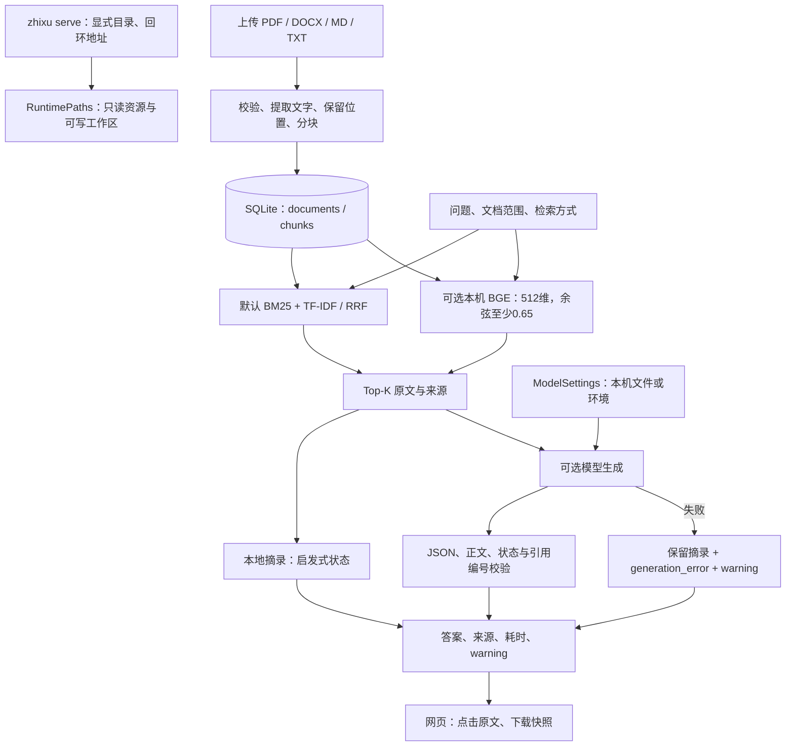

# 知序 1.2 架构与代码地图

知序默认是本机个人资料工作台，默认空库、字面检索与逐字摘录。显式开启 `--enterprise` 后，变为单组织的账号与多空间模式：请求先验证会话、CSRF 和角色，再选择该空间的独立 SQLite 知识库。原个人数据库不自动共享。可选 BGE 改变检索方式，兼容生成服务组织新答案；两者独立，均不代表自动事实验证。项目使用预训练模型，没有训练或微调模型，也没有 Agent 工具循环。

## 团队权限边界

`identity.py` 保存 Argon2id 密码哈希、会话摘要、空间成员和审计。`enterprise.py` 在业务处理前验证身份与空间，viewer 只能读取和问答，editor/空间 admin 可维护资料，系统管理员才可管理账号、授权、模型和全局评测。客户端仅提交空间 ID，不提交服务器文件路径；经授权的 ID 才能选择 `data/workspaces/<id>/knowledge.db`。知识内容去重也在各自数据库内进行。

会话用 HttpOnly/SameSite Strict cookie，HTTPS 公共来源启用 Secure；修改请求需要会话 CSRF，Origin 按 scheme、主机和有效端口比较。密码修改/重置和账号停用会吊销会话；成员授权每次请求重新验证。审计只存标识、动作、结果与请求 ID，不存问题、文档、密码或密钥，也不宣称不可篡改。

`backup.py` 通过 SQLite backup API 创建逐库一致快照，只归档允许的数据库与配置，校验清单、字节数、SHA256 和 SQLite 完整性；恢复在 staging 完整校验后发布到新的空目录。控制库快照和旧归档恢复都剥离活动会话，避免旧 cookie 复活。它不提供跨数据库原子快照或加密存储。具体操作与未验证部署范围见 [团队运维](enterprise-operations.md)。

## 数据流

删除文档时 SQLite 级联移除片段，同时使字面和语义索引失效。模型对象可以缓存，片段向量仍需随资料更新。历史快照不自动撤回，也不删除用户原文件。

## 安装资源与运行目录

`app/paths.py:RuntimePaths.discover` 把包内资源与可写目录分开：

| 位置 | 内容与优先级 |
| --- | --- |
| `app/resources/demo/` | 包内 8 份虚构演示资料；默认不导入，CLI `--demo` 只在新数据库导入 |
| `app/resources/evaluation/` | 包内固定题集，供安装后的评测使用；源码根目录保留原始题集 |
| `app/static/` | 页面、样式、脚本与本地 Swagger UI 资产；随 wheel 打包 |
| data directory | CLI `--data-dir` > `ZHIXU_DATA_DIR` > 当前工作目录 `data/`；包含 `knowledge.db`、`model-config.json` |
| model directory | CLI `--model-dir` > `ZHIXU_MODEL_DIR` > data 同级 `models/` |
| report directory | `ZHIXU_REPORT_DIR` > data 同级 `reports/`；运行报告不写入包目录 |

`create_app` 也接受测试/集成用数据库、模型与报告路径。默认个人空间不灌入模拟公司；文档页可显式恢复示例。内容相同的字节按 SHA256 去重，同名不同内容不会自动覆盖。

源码与公开 wheel 不含模型权重、生成服务器二进制、数据库或个人配置。历史 Windows 离线资源包保留在本地，不是当前公开发行包，也不等于跨平台运行时已分发。

## 代码入口

| 文件 / 函数 | 责任 |
| --- | --- |
| `app/cli.py:main` | CLI 参数、回环地址、端口和目录；前台启动 uvicorn |
| `app/main.py:create_app` | HTTP 参数、上传、模型设置、问答、评测与静态页面编排 |
| `app/ingestion.py:parse_document / split_text` | 类型与总预算；长文本默认 900 字符、重叠 120 |
| `app/docx_ingestion.py:extract_docx_sections` | ZIP 预检，复用 python-docx 提取正文段落和表格行 |
| `app/store.py:Store` | 每操作 SQLite 连接、参数化 SQL、事务和外键级联 |
| `app/service.py:KnowledgeService` | 去重、生命周期、索引失效、摘录、启发式不足与冲突状态 |
| `app/retrieval.py:Retriever` | 中文二元/三元字符片段、英文数字词、字面候选筛选与排序 |
| `app/semantic.py:SemanticRetriever` | 本地模型就绪与加载、片段/问题编码、余弦检索 |
| `app/model_settings.py:ModelSettings` | 文件/环境配置、脱敏状态、原子保存与即时切换 provider |
| `app/provider.py:ModelProvider.generate` | 兼容请求、网络/格式错误、JSON 和引用校验 |
| `app/evaluation.py:evaluate / calculate_metrics` | 临时资料库、固定题与逐题结果，分别定义 Hit/Recall/完整来源 |
| `app/static/app.js` | 来源抽屉、模型表单、文件管理、快照与评测显示 |

完整接口与参数见 [API 手册](api.md)。`/api/docs` 使用随包本地 Swagger UI 资产，`/openapi.json` 提供机器可读定义，无需 CDN。

## 解析与存储

TXT/MD 按空行分非空段，Markdown 标题关联后续正文；长段再窗口切分。PDF 按页提取。DOCX 按正文顺序读取段落和表格行，位置形如“第 3 段”“表 1 · 第 2 行”，不计算 Word 排版页码；页眉、文本框等不是完整 Word 渲染支持。

`documents` 保存 `id, filename, kind, byte_size, chunk_count, created_at, sha256`；`chunks` 保存 `id, document_id, ordinal, location, text`。数据库保存提取文本和元数据，不保存原始二进制文件；索引存在内存，不使用专门向量数据库。会话仅在浏览器页面内存，不持久化多轮上下文。

单文件 10 MiB，提取文字 200 万字符。PDF 最多 200 页，单内容流 8 MiB、累计 24 MiB 解压预算、Form 深度 16；DOCX 最多 2000 个 ZIP 成员，单成员 8 MiB、累计 24 MiB，并检查路径、实际解压量、宏和实体声明。无 OCR，无解析进程硬超时；预算不等于严格资源沙箱。

## 两种检索表示

BM25 按词频、稀有度和长度打分；TF-IDF 是词项统计稀疏向量，归一化后作余弦比较。两者依赖字面重合，不是神经 embedding。三种字面排序先共享 TF-IDF 相似度至少 0.06 的门限；问题词项不少于 4 时，还要求交集至少 2 个、覆盖至少 10%。所以 BM25 行是共享候选集的排序消融，不是独立纯 BM25 基线。

RRF 对两个榜单累加 `1/(60+rank)`。它避免直接相加不同量纲的分数，不能找回已过滤候选。默认前五是片段，不是五个不同文件。

可选 BGE-small-zh-v1.5 为 512 维神经表示；片段和问题向量归一化，固定余弦至少 0.65。它独立于字面候选门限，没有加入 RRF 或 reranker。CPU 2 线程、`local_files_only=True`，正常查询不下载；显式下载脚本写就绪清单。健康检查不提前加载模型、不每次重新哈希权重；首次实际加载仍可能失败。长片段可能被编码器截断，语义相关也不代表答案充分。

公开历史实验见 [原 64 题报告](benchmarks/evaluation.md) 和 [36 题确认](benchmarks/semantic-confirmation.md)。三种字面排序无质量提升证据；确认集中 BGE 更保守，也漏掉更多有依据题，不能说整体更好。两组均是同一虚构业务域，不是生产外部基准。

## 模型设置与生成边界

`ModelSettings` 从 data 中的 `model-config.json` 读取。服务启动时还会读取 data 同级 `.env`（不覆盖已有进程环境）；存在的 `RAG_BASE_URL/RAG_MODEL/RAG_API_KEY` 按字段覆盖文件。存在环境管理或注入 provider 时，网页显示只读，不能覆盖。GUI 保存后切换 provider，无需为文件设置重启；环境变更需重启。

配置文件包含明文 key，临时文件原子替换并请求本机文件权限；不是系统钥匙串，也不承诺 Windows ACL 隔离。API 只返回 `has_api_key` 等状态，不返回 key。地址不变且省略 key 时保留旧值；地址变化时不转移旧 key，清除选项可显式移除。浏览器不把它存入 localStorage。

本机回环服务允许 HTTP/无 key，远端要求 HTTPS 且非空 key 才启用。保存配置不会发送用户文档；连接测试会把固定合成文本发送到已保存服务，外部服务可能收费。

生成只在 `mode=llm`、配置启用且有检索来源时进行。要求 Chat Completions 与 JSON object，校验正文、状态、引用整数范围及编号集合一致；`insufficient` 可无引文。校验不是语义蕴含或事实证明。

没有配置时请求生成返回 503；没有来源时直接返回不足；实际模型超时、格式或引用失败时，问答接口保留原摘录，附 `generation_error`、`warning` 与降级 trace，`mode` 仍是 `extractive`。连接测试失败则返回 502，不与问答降级混淆。网络超时与响应体上限不是端到端硬截止。

本机已用官方 Qwen3-0.6B/Qwen2.5-1.5B GGUF 与 llama.cpp 做真实 CPU 合成请求。早期小模型多次未满足正文/JSON/引用严格契约，失败记录保留；后续通用格式示例下，1.5B 实际 provider 对两道合成有依据/缺失问题通过所检查的协议和事实。它是小样本冒烟验证，不能证明稳定或适合所有业务。模型与运行时来源见 [第三方说明](third-party.md)。

## 信任与评测

文件、问题和模型输出都不可信；文本显示、Host/Origin 检查和 CSP 是分层限制，不替代认证或操作系统隔离。当前单用户回环工具没有多人权限或生产部署保障，文档内容不获得工具执行权限。生成目标可能是远端，使用者需要明确资料发送许可。

Hit@5 看至少一份参考文件；标准来源 Recall@5 是已召回参考文件比例的逐题平均；完整来源@5 要全部齐全。引用原文/编号有效和关键词覆盖不是答案正确率。评测使用独立临时库，不改当前上传资料；预热本地耗时不等于浏览器或外部模型延迟。确认集看过后可分析失败，若据其调参应另建冻结集；见 [协议](semantic-confirmation-protocol.md)。
